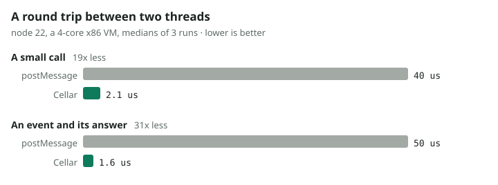

# Cellar (`@bottlify/cellar`)

**Many threads. One memory.**

Cellar is a lightweight shared-memory library for multithreaded JavaScript. Threads share data,
call each other, stream records and wait on each other through shared memory, without going
through the event loop for every exchange.

- **Cache** - bodies in shared memory, read in place by name from any thread, under one memory
  budget, idle ones kept on the disk (OPFS) and brought back when asked.
- **Channel** - calls between two threads, blocking or not, the request and the answer read where
  they lie.
- **Ring** - a bounded stream of records one way, read in place, a full ring refusing rather than
  overwriting.
- **Bell** - one thread waits on a shared word, another wakes it, and only when it sleeps.
- **Doorbell** - one wait for everything a thread is sent, whatever it came through.

Cellar is browser code: a page and its workers sharing memory, in a cross-origin isolated page.
Node runs it too (its tests run there), with `worker_threads` for workers. It works with what the
platform has: a thread blocks only where the platform lets it (a worker, never a page's own
thread), and a wait on the event loop uses `Atomics.waitAsync` where there is one.

Built for [Bottlify](https://github.com/bottlify/bottlify), whose processes and workers share
memory and wait on each other; nothing in it is Bottlify's, and it suits any page that runs work in
several threads. No runtime dependencies, the browser's own primitives (`SharedArrayBuffer`,
`Atomics`, OPFS), MPL-2.0.




The figures are `examples/call-a-worker.mjs`, `examples/memory.mjs` and `examples/ring.mjs`
(node 22, a 4-core x86 VM, 3 runs an arm, medians); the tables below give every number. How each
mechanism works, drawn: [examples/README.md](examples/README.md).

Status: the bell, the ring, the channel and the cache, each with its gate.

## Install

Not on npm yet. Every version is built into a
[release](https://github.com/bottlify/cellar/releases): `cellar.js`, `cellar.min.js`, the
declarations (`types/`) and their checksums; take them from there. The examples below import it
by the name it will have on npm.

## Use

The keeper runs in one thread. It hands out the index and the segments every thread reads:

```js
import { openKeeper } from '@bottlify/cellar';

const keeper = await openKeeper({
    budget: 256 << 20,           // bytes of shared memory for hot bodies, at most
    disk,                        // OPFS sync handles, or null for memory only
    announce: message=>workers.forEach(worker=>worker.postMessage(message)),
});
// Each worker gets keeper.shared and keeper.segmentBuffers(); the keeper sweeps idle bodies.
setInterval(()=>keeper.sweep(), 1000);
```

Each thread reads through a reader. It reaches the keeper only for room to write and for a body
to be brought back from the disk, through whatever blocking call its threads already have:

```js
import { createReader } from '@bottlify/cellar';

const cache = createReader({ shared, segments, keeper: calls });
self.onmessage = event=>cache.adopt(event.data);   // segments made and let go

const sum = cache.with('blocks/42', body=>checksum(body));   // undefined on a miss
const into = cache.reserve('blocks/43', length);              // write in place
into?.set(bytes);
cache.commit('blocks/43');
```

A body is read only inside `with`: the keeper never takes a body a reader is in. A body that can
be made again goes away when there is no room and no disk; one marked `onlyCopy` never does.

A `reserve` the keeper refuses leaves the name's body as it was; one it grants takes it, and
`commit` makes the new one readable. A writer that fails between the two calls `abandon(name)`:
the name has no body then, and the room goes back. A thread joining later is handed
`keeper.shared` and `keeper.segmentBuffers()` as they are then. A write the disk takes in part
counts as not written. `save()` writes the hot bodies the disk lacks, then an index of exactly the
bodies the disk holds, after the packs are flushed: the index is always true, and `false` says some
body stayed in memory only (the disk refused it, or the next pack was not open yet). A save that
fails at the index leaves the last whole one, which the next run reads; an entry of it that does
not fit its pack's file is skipped and counted (`skippedEntries`). After `close()` the files are
let go and the keeper goes on in memory, as without a disk.
The idle spans (`coldAfterMs`, `goneAfterMs`, `releaseAfterMs`) are under 24.8 days: the keeper's
clock is a 32-bit word. Records and names are not reused within a run: a run holds 2^20 records
and 2^25 UTF-16 units of names, past which a new name is refused. The `raise` a reader is given
takes `{ known }`, the segments that reader has: a body is brought back only where it can read it.

## Channel

Calls between two threads without a message: a request is written where the other thread reads it,
the answer where the asking thread reads it, each side sleeping on a shared word until rung. A
message clones what it carries and waits for the other thread's event loop; a channel copies a
request once and need not wait for anything but the answer. What is large is not sent at all: the
request names where it lies (a body in the cache, a range of a shared buffer).

```js
import { createChannel, openClient, openServer } from '@bottlify/cellar';

const channel = createChannel({ slots: 16, slotBytes: 4096 });   // slots a power of two; hand it to both threads

// In the worker: answer each request, read in place.
const server = openServer(channel);
for (;;) server.serve(request=>answerTo(request));   // blocks; serveAsync keeps the event loop

// In the asking thread: blocking (a worker) or not (any thread, a page's own too).
const client = openClient(channel);
const answer = client.ask(request);                  // a copy, or { read } reads it in place
const later = await client.call(request);
```

One asking side and one serving side for the channel's life; a thread that needs a new link (a
worker started again) makes a new channel. Answers come back in order, as many requests out at
once as there are slots; a call waiting for room goes out as soon as one answer frees a slot. A
blocking ask makes no garbage, answered at once or after its handler worked a while: the request
and answer are read where they lie, and a wait reads the clock only when it has a deadline.

A handler that throws, or answers more than a slot holds, answers its request with the failure:
the call or ask fails with `ChannelFailed`, saying what the handler threw (as much as a slot
holds), and the next request is served. A `serve` from inside its own handler, and an `ask` or a
`call` from inside the reading of an answer, throw: each would take a slot that is in use. An
`ask` on a thread that may not block throws there when it would sleep, and its answer, when it
comes, goes to nobody.

`examples/memory.mjs` calls a function in a worker by postMessage and by the channel, each arm in a
process of its own (node 22, a 4-core x86 VM, 3 runs an arm, medians):

| | postMessage | channel |
| --- | --- | --- |
| a small call (100 000): time | 40 us | 2.1 us |
| collections, asking thread / worker | 80 / 34 | 8 / 0 (the 8: the process's start) |
| peak resident memory | 99 MiB | 79 MiB |
| 8 MiB of samples summed (200): time | 5.6 ms | 1.3 ms |
| collections in the worker | 52 | 0 |
| the worker's buffers at most | 32 MiB (copies) | 0 |
| peak resident memory | 140 MiB | 77 MiB |

`examples/call-a-worker.mjs` shows the same calls as a page would write them.

## Ring and bell

The channel is calls; a ring is records one way, of any length, read in place: one writer, one
reader, a record that does not fit refused rather than overwritten. Both stand on the bell, the one
way two threads wait on each other here: a wait looks at a shared word for a moment, then sleeps
on it, counted beside it; whoever moves the word notifies only when a wait sleeps. A doorbell is a
bell several rings share, so a thread reading several waits once for all of them.

```js
import { createRingMemory, openRing, createDoorbell, openDoorbell } from '@bottlify/cellar';

const bell = createDoorbell();                       // one per reading thread
const memory = createRingMemory(1 << 20, bell);      // hand it to both threads

openRing(memory).write(bytes);                       // the writer: false when it does not fit

const ring = openRing(memory);                       // the reader
const doorbell = openDoorbell(bell);
for (;;)
{
    const seen = doorbell.seen();                    // before the look: nothing written after it is missed
    ring.drain(record=>take(record));                // each record a view, valid inside the call
    doorbell.wait(seen);                             // blocks; waitAsync keeps the event loop
}
```

A writer that may not block (a page) waits for room with `writeWaitingAsync`; `drain(take, most)`
takes at most `most` records, so one ring written without a pause does not starve the others a
thread reads (a reader that took `most` drains again before it waits: what is left will not ring
again). Either side closes a ring when it goes or knows the other went: a writer waiting for
room, and every write after, end with `RingClosed`, and the reader is rung to find it closed after
reading what was written before. A `take` may not drain its own ring (it holds the record being
taken), and `release` frees only a record `peek` returned: either throws rather than free a
record not read. A record is bytes: a `Uint8Array` or an array of numbers; a wider typed array, a
`DataView` or a buffer is refused.

`waitFor`, `waitForAsync`, `wake`, `publish` and `ring` are the bell over any word of a shared
`Int32Array`, for a protocol of its own; `deadlineOf(timeoutMs)` is a deadline on the clock they
read, and `SPIN_MS` how long a blocking wait looks before it sleeps. A timeout or a spin that is
not a number is refused. The count of waits asleep is kept by the waits themselves: a worker
terminated while asleep stays counted, and every move after notifies once for it (about 50 ns more a move, x86).

`examples/ring.mjs` sends 20 000 pointer moves to a worker busy with 2 000 steps of work, then
2 000 events one at a time to it idle, each answered (node 22, a 4-core x86 VM, 3 runs, medians):

| | postMessage | ring |
| --- | --- | --- |
| a step of the busy worker (it yields after each to hear a message) | 206 us | 183 us |
| an event there and back, the worker idle | 50 us | 1.6 us |

## Requirements

- `SharedArrayBuffer`, in a cross-origin isolated page, for anything shared between threads.
  Without it the cache is one thread's, on buffers of its own, and works the same there.
- Growable buffers (`maxByteLength`) for the cache's index: an engine without them is told so
  when the keeper opens.
- `Atomics.waitAsync` for waits on the event loop (`waitForAsync`, `call`, `serveAsync`,
  `writeWaitingAsync`); where there is none they look again every millisecond.
- The disk (OPFS synchronous handles, in a worker) is optional.

## Develop

```sh
npm ci
npm run check     # types (JSDoc, tsc), unit tests, the concurrency gate, the build
```

`npm run build` writes `dist/`: one ES module (`cellar.js`, `cellar.min.js`), the declarations
(`types/`) and `checksums.json`. A push to `main` runs the same checks on GitHub and, for a
version in `package.json` no release carries yet, releases it with the built files.

## License

[MPL-2.0](LICENSE).
