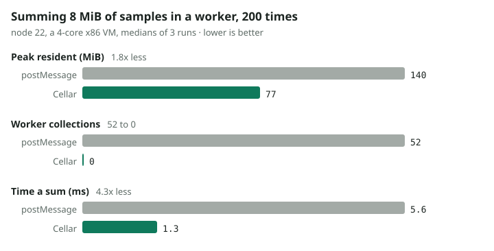

# Cellar (`@bottlify/cellar`)

**Many threads. One memory.**

Cellar is a lightweight shared-memory library for multithreaded JavaScript. Threads share data,
call each other, stream records and wait on each other through shared memory, without going
through the event loop for every exchange.

- **Cache** - bodies in shared memory, read in place by name from any thread, under one memory
  budget, idle ones kept on the disk (OPFS) and brought back when asked.
- **Channel** - calls between two threads, blocking or not, the request and the answer read where
  they lie.
- **Ring** - a bounded stream of records one way, read in place, a full ring refusing rather than
  overwriting.
- **Journal** - records one thread writes and any number read, the newest kept and the oldest
  written over: a log, a trace, the times frames were shown. The writer never waits.
- **Bell** - one thread waits on a shared word, another wakes it, and only when it sleeps.
- **Doorbell** - one wait for everything a thread is sent, whatever it came through.

Cellar is browser code: a page and its workers sharing memory, in a cross-origin isolated page.
Node runs it too (its tests run there), with `worker_threads` for workers. It works with what the
platform has: a thread blocks only where the platform lets it (a worker, never a page's own
thread), and a wait on the event loop uses `Atomics.waitAsync` where there is one.

Built for [Bottlify](https://github.com/bottlify/bottlify), whose processes and workers share
memory and wait on each other; nothing in it is Bottlify's, and it suits any page that runs work in
several threads. No runtime dependencies, the browser's own primitives (`SharedArrayBuffer`,
`Atomics`, OPFS), MPL-2.0.




The figures are `examples/call-a-worker.mjs`, `examples/memory.mjs` and `examples/ring.mjs`
(Cellar 0.5.9, node 22, a 4-core x86 VM, 3 runs an arm, medians); the tables below give every number. How each
mechanism works, drawn: [examples/README.md](examples/README.md).

Status: the bell, the ring, the channel and the cache, each with its gate.

## Install

Not on npm yet. Every version is built into a
[release](https://github.com/bottlify/cellar/releases): `cellar.js`, `cellar.min.js`, the
declarations (`types/`) and their checksums; take them from there. The examples below import it
by the name it will have on npm.

## Use

Every example below is two files: `page.js`, the page's own thread, which may never block, and
`worker.js`, a module worker, which may. The shared memory is made on one side and handed to the
other once, by `postMessage`; from then on the two talk through it.

The keeper runs in one thread, here the page's. It hands each worker the index and the segments,
and answers the few calls a worker makes of it (room to write, a body brought back from the disk)
over a channel:

```js
// page.js
import { createChannel, openKeeper, openServer } from '@bottlify/cellar';

/** @type {Worker | undefined} */
let worker;
const keeper = await openKeeper({
    budget: 256 << 20,                                   // bytes of shared memory for hot bodies, at most
    disk: null,                                          // or OPFS sync handles, opened in a worker
    announce: message=>worker?.postMessage(message),     // segments made and let go, a larger table
});
setInterval(()=>keeper.sweep(), 1000);                   // idle bodies go cold, then away

// The worker's calls to the keeper, answered on the page's event loop.
const channel = createChannel();
const server = openServer(channel);
const encoder = new TextEncoder();
const decoder = new TextDecoder();
(async()=>{
    for (;;)
    {
        await server.serveAsync(request=>{
            const { op, name, length, options } = JSON.parse(decoder.decode(request));
            const answer = op === 'reserve' ? keeper.reserve(name, length, options)
                : op === 'raise' ? keeper.raise(name, options) : keeper.drop(name);
            return encoder.encode(JSON.stringify(answer));
        });
    }
})();

// The index and the segments as they are now; the ones made after come by `announce`.
worker = new Worker(new URL('./worker.js', import.meta.url), { type: 'module' });
worker.postMessage({ shared: keeper.shared, segments: keeper.segmentBuffers(), channel });
```

```js
// worker.js
import { createReader, openClient } from '@bottlify/cellar';

const encoder = new TextEncoder();
const decoder = new TextDecoder();
let cache = null;

self.onmessage = ({ data })=>{
    if (data.shared === undefined)
    {
        cache.adopt(data);                               // a segment made or let go, a larger table
        return;
    }
    const client = openClient(data.channel);
    const send = call=>encoder.encode(JSON.stringify(call));
    // A worker may block: room to write is asked and waited for.
    const ask = call=>JSON.parse(decoder.decode(client.ask(send(call))));
    cache = createReader({ shared: data.shared, segments: data.segments, keeper: {
        reserve: (name, length, options)=>ask({ op: 'reserve', name, length, options }),
        raise: (name, options)=>ask({ op: 'raise', name, options }),
        raiseLater: name=>{
            client.call(send({ op: 'raise', name })).catch(()=>{});   // not waited for
        },
        drop: name=>{
            client.call(send({ op: 'drop', name })).catch(()=>{});
        },
    } });

    cache.put('blocks/42', bytes);                       // reserve, copy, commit
    const sum = cache.with('blocks/42', body=>checksum(body));   // read in place; undefined on a miss
};
```

A body is read only inside `with`: the keeper never takes a body a reader is in. A body that can
be made again goes away when there is no room and no disk; one marked `onlyCopy` never does.
`disk` says where a body may go on the disk: `'kept'` (the default) there and in the saved index
for the next run; `'run'` there while cold, never named in the index, for a body that means
nothing to the next run (texels a GPU was handed); `'never'` not at all, so an idle body that can
be made again goes away and an only copy stays in memory.

A `reserve` the keeper refuses leaves the name's body as it was; one it grants takes it, and
`commit` makes the new one readable. A writer that fails between the two calls `abandon(name)`:
the name has no body then, and the room goes back. A thread joining later is handed
`keeper.shared` and `keeper.segmentBuffers()` as they are then. A write the disk takes in part
counts as not written. `save()` writes the hot bodies the disk lacks, then an index of exactly the
bodies the disk holds, after the packs are flushed: the index is always true, and `false` says some
body stayed in memory only (the disk refused it, or the next pack was not open yet). A save that
fails at the index leaves the last whole one, which the next run reads; an entry of it that does
not fit its pack's file is skipped and counted (`skippedEntries`). `announce` and the disk's methods run on the keeper's thread in the middle of its work: they call
none of its methods. One that throws is counted (`announceFailures`, `diskFailures`) and the keeper
goes on: a thread not told of a segment is never placed in it. After `close()` the files are
let go and the keeper goes on in memory, as without a disk: a hot body stays (an only copy for
good), a cold one is the next run's, on the disk, and no body of this run any more.
`budget` is a finite number of bytes; `segmentBytes` a power of two from 4 KiB to 1 GiB;
`packBytes` under 2 GiB; a body's length a whole number of bytes. The idle spans (`coldAfterMs`,
`goneAfterMs`, `releaseAfterMs`) are under 24.8 days: the keeper's
clock is a 32-bit word. Records and names are not reused within a run: a run holds 2^20 records
and 2^25 UTF-16 units of names, past which a new name is refused. The `raise` a reader is given
takes `{ known }`, the segments that reader has: a body is brought back only where it can read it.

## Channel

Calls between two threads without a message: a request is written where the other thread reads it,
the answer where the asking thread reads it, each side sleeping on a shared word until rung. A
message clones what it carries and waits for the other thread's event loop; a channel copies a
request once and need not wait for anything but the answer. What is large is not sent at all: the
request names where it lies (a body in the cache, a range of a shared buffer).

```js
// page.js - the page's own thread may not block: it calls and awaits.
import { createChannel, openClient } from '@bottlify/cellar';

const channel = createChannel({ slots: 16, slotBytes: 4096 });   // slots a power of two
const worker = new Worker(new URL('./worker.js', import.meta.url), { type: 'module' });
worker.postMessage({ channel });                                 // the shared memory, once

const client = openClient(channel);
const sum = await client.call(Uint8Array.of(1, 2, 3), { read: answer=>answer[0] });   // 6
client.close();                                                  // the worker's serve ends
```

```js
// worker.js - a worker may block: it serves, asleep on the channel between requests.
import { ChannelClosed, openServer } from '@bottlify/cellar';

self.onmessage = ({ data })=>{
    const server = openServer(data.channel);
    try
    {
        for (;;)
        {
            // The request read where it lies; the answer's bytes returned.
            server.serve(request=>[request.reduce((sum, value)=>sum + value, 0)]);
        }
    }
    catch (e)
    {
        if (!(e instanceof ChannelClosed))
        {
            throw e;
        }
    }
};
```

A worker that asks blocks for its answer, with no promise and no garbage: `client.ask(request)`
answers it at once (a copy, or `{ read }` reads it in place). A worker that must keep its event
loop serves with `await server.serveAsync(handler)` instead of `serve`.


One asking side and one serving side for the channel's life; a thread that needs a new link (a
worker started again) makes a new channel. Answers come back in order, as many requests out at
once as there are slots; a call waiting for room goes out as soon as one answer frees a slot. A
blocking ask makes no garbage, answered at once or after its handler worked a while: the request
and answer are read where they lie, and a wait reads the clock only when it has a deadline.

A handler that throws, or answers more than a slot holds, answers its request with the failure:
the call or ask fails with `ChannelFailed`, saying what the handler threw (as much as a slot
holds), and the next request is served. A `serve` from inside its own handler, and an `ask` or a
`call` from inside the reading of an answer, throw: each would take a slot that is in use. An
`ask` on a thread that may not block throws there when it would sleep, and its answer, when it
comes, goes to nobody.

`examples/memory.mjs` calls a function in a worker by postMessage and by the channel, each arm in a
process of its own (node 22, a 4-core x86 VM, 3 runs an arm, medians):

| | postMessage | channel |
| --- | --- | --- |
| a small call (100 000): time | 38 us | 2.2 us |
| collections, asking thread / worker | 80 / 34 | 8 / 0 (the 8: the process's start) |
| peak resident memory | 88 MiB | 80 MiB |
| 8 MiB of samples summed (200): time | 5.8 ms | 1.3 ms |
| collections in the worker | 50 | 0 |
| the worker's buffers at most | 32 MiB (copies) | 0 |
| peak resident memory | 133 MiB | 77 MiB |

`examples/call-a-worker.mjs` shows the same calls as a page would write them.

## Ring and bell

The channel is calls; a ring is records one way, of any length, read in place: one writer, one
reader, a record that does not fit refused rather than overwritten. Both stand on the bell, the one
way two threads wait on each other here: a wait looks at a shared word for a moment, then sleeps
on it, counted beside it; whoever moves the word notifies only when a wait sleeps. A doorbell is a
bell several rings share, so a thread reading several waits once for all of them.

```js
// page.js - pointer moves to a worker busy with long work, which reads them between its steps.
import { createDoorbell, createRingMemory, openRing } from '@bottlify/cellar';

const bell = createDoorbell();                       // one per reading thread
const memory = createRingMemory(1 << 16, bell);
const worker = new Worker(new URL('./worker.js', import.meta.url), { type: 'module' });
worker.postMessage({ memory });

const ring = openRing(memory);
const record = new Uint8Array(8);
const fields = new DataView(record.buffer);
addEventListener('pointermove', event=>{
    fields.setInt32(0, event.clientX, true);
    fields.setInt32(4, event.clientY, true);
    ring.write(record);                              // false when the ring is full
});
```

```js
// worker.js
import { openDoorbell, openRing } from '@bottlify/cellar';

self.onmessage = ({ data })=>{
    const ring = openRing(data.memory);
    const doorbell = openDoorbell(data.memory.bell);
    while (!ring.closed())
    {
        const seen = doorbell.seen();                // before the look: nothing written after it is missed
        ring.drain(record=>{                         // each record a view, valid inside the call
            const fields = new DataView(record.buffer, record.byteOffset, record.length);
            move(fields.getInt32(0, true), fields.getInt32(4, true));
        });
        doorbell.wait(seen);                         // blocks; waitAsync keeps the event loop
    }
};
```

A record need not be built elsewhere and copied in: `reserve(length)` gives room for one at
`ring.bytes[at]`, the writer builds it there, and `commit(length)` publishes it, as long as it
turned out (no longer than was reserved); `abandon()` gives the room back. One reservation at a
time; `reserveWaiting` and `reserveWaitingAsync` wait for room as the writes do. `write` is the
same three steps with a copy between.

```js
// recorder.worker.js - a batch of commands for another worker, built where it will be read.
const at = ring.reserveWaiting(BATCH_BYTES);         // blocks until the reader makes room
const words = new DataView(ring.bytes.buffer);
let end = at;
for (const command of commands)
{
    words.setUint32(end, command.op, true);
    words.setUint32(end + 4, command.argument, true);
    end += 8;
}
ring.commit(end - at);
```

A writer that may not block (a page) waits for room with `writeWaitingAsync`; `drain(take, most)`
takes at most `most` records, so one ring written without a pause does not starve the others a
thread reads (a reader that took `most` drains again before it waits: what is left will not ring
again). Either side closes a ring when it goes or knows the other went: a writer waiting for
room, and every write after, end with `RingClosed`, and the reader is rung to find it closed after
reading what was written before. A `take` may not drain its own ring (it holds the record being
taken), and `release` frees only a record `peek` returned: either throws rather than free a
record not read. A record is bytes: a `Uint8Array` or an array of numbers; a wider typed array, a
`DataView` or a buffer is refused.

`waitFor`, `waitForAsync`, `wake`, `publish` and `ring` are the bell over any word of a shared
`Int32Array`, for a protocol of its own; `deadlineOf(timeoutMs)` is a deadline on the clock they
read, and `SPIN_MS` about how long a blocking wait looks before it sleeps (a second at most) (counted in looks, not
time: a wait with no deadline never reads the clock). A doorbell's, a ring writer's and a channel
end's waits learn how long to look (`createSpin`, also a `spinMs` of `waitFor`): a wait that went
to sleep all the same makes the next look an eighth less, down to a few hundred looks, one that
saw the word move keeps twice what it needed, and one in sixteen looks the whole way; so a side
that waits on long work stops spinning a core away from the side doing it; what each learnt is
`doorbell.spin`, `ring.roomSpin` and a channel end's `spin`. A wait given a `spinMs` of its own
looks that long. A timeout or a spin that is
not a number is refused. The count of waits asleep is kept by the waits themselves: a worker
terminated while asleep stays counted, and every move after notifies once for it (about 50 ns more a move, x86).

`examples/ring.mjs` sends 20 000 pointer moves to a worker busy with 2 000 steps of work, then
2 000 events one at a time to it idle, each answered (node 22, a 4-core x86 VM, 3 runs, medians):

| | postMessage | ring |
| --- | --- | --- |
| a step of the busy worker (it yields after each to hear a message) | 190 us | 164 us |
| an event there and back, the worker idle | 38 us | 1.5 us |

`examples/batches.mjs` hands batches of bytes from one worker to another, the same work to build
and to read each way: posted with the buffer transferred and posted back, copied into a ring
(`write`), and built in the ring (`reserve`, `commit`). Batches go one after another, a gibibyte a
run (a million batches at most). Wall time a batch, and in brackets the processor time of both
threads a batch, their waits included: a ring's side looks a moment before it sleeps, a posting
side sleeps in its event loop (node 26 / node 22, a 4-core x86 VM, load ~3.5, 5 runs an arm
alternated, medians):

| batch | postMessage | ring `write` | ring `reserve` |
| --- | --- | --- | --- |
| 64 B | 3.6 / 3.8 us (6.1 / 6.7) | 0.35 / 0.33 us (0.57 / 0.59) | 0.35 / 0.34 us (0.62 / 0.59) |
| 8 KiB | 10.5 / 8.2 us (16.4 / 14.4) | 4.5 / 4.4 us (8.6 / 8.2) | 4.0 / 3.1 us (7.3 / 5.4) |
| 64 KiB | 86 / 40 us (111 / 62) | 26 / 30 us (44 / 56) | 20 / 19 us (36 / 34) |
| 256 KiB | 312 / 128 us (387 / 203) | 95 / 147 us (168 / 201) | 69 / 70 us (124 / 128) |

A post transfers its buffer and copies nothing; `write` copies the batch in, which for a large
one costs about what a post does on node 22 (node 26 pays a post in proportion to its size). Built
in the ring, a batch is copied by nobody and costs least on both. With four other threads busy on
the same four cores, the waits that learn their spin take 64 KiB built in the ring from 43 to 34 us
of processor time a batch.

## Journal

A ring hands every record to its one reader and makes the writer wait when it is full; a journal
never makes its writer wait. Any number of threads read it, each by sequence, and a reader that
falls behind finds the records the writer lapped gone, never torn.

```js
// engine.worker.js - the writer: a record built where it will be read.
import { createJournalMemory, openJournal } from '@bottlify/cellar';

const memory = createJournalMemory({ records: 4096, bytes: 1 << 20 });
postMessage({ journal: memory });                     // to whoever reads it
const journal = openJournal(memory);
const words = new DataView(journal.bytes.buffer);
function note(level, value){
    const at = journal.reserve(16);                   // eight-aligned, whole in the buffer
    words.setUint32(at, level, true);
    words.setFloat64(at + 8, value, true);
    return journal.commit();                          // its sequence
}
```

```js
// page.js - a reader, as late as it likes.
import { openJournal } from '@bottlify/cellar';

worker.onmessage = ({ data })=>{
    const journal = openJournal(data.journal);
    const words = new DataView(journal.bytes.buffer);
    let next = journal.oldest();
    setInterval(()=>{
        for (const end = journal.written(); next !== end; next = (next + 1) >>> 0)
        {
            // In place, inside the call: undefined if the writer reached it first.
            const value = journal.read(next, (_bytes, at)=>words.getFloat64(at + 8, true));
            if (value !== undefined) show(value);
        }
    }, 250);
};
```

`read(sequence, take)` hands `take` the buffer, the record's offset and length, and answers what
`take` returns, or undefined when the record was not there: not written yet, lapped before the
read, or reached by the writer while `take` read it (the writer moves its count of bytes before
it writes one, and the read checks it after). So `take` decodes or copies what it keeps and keeps
nothing of the view. `oldest()` and `written()` bound what can be asked for; `first` in the
memory's options starts the count where a journal it takes over from ended. Counts wrap at 2^32
and are compared by their difference. Over an `ArrayBuffer` (`shared: false`) the readers are on
the writer's own thread. Writing a record and reading it back make nothing on the heap.

## Requirements

- `SharedArrayBuffer`, in a cross-origin isolated page, for anything shared between threads.
  Without it the cache is one thread's, on buffers of its own, and works the same there.
- Growable buffers (`maxByteLength`) for the cache's index: an engine without them is told so
  when the keeper opens.
- `Atomics.waitAsync` for waits on the event loop (`waitForAsync`, `call`, `serveAsync`,
  `writeWaitingAsync`); where there is none they look again every millisecond.
- The disk (OPFS synchronous handles, in a worker) is optional.

## Develop

```sh
npm ci
npm run check     # types (JSDoc, tsc), unit tests, the concurrency gate, the build
```

`npm run build` writes `dist/`: one ES module (`cellar.js`, `cellar.min.js`), the declarations
(`types/`) and `checksums.json`. A push to `main` runs the same checks on GitHub and, for a
version in `package.json` no release carries yet, releases it with the built files.

## License

[MPL-2.0](LICENSE).
