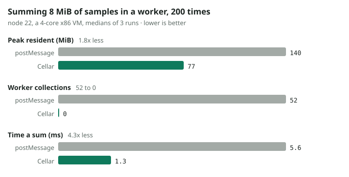

# Benchmarks

[Home](../README.md) · [Runnable examples](../examples/README.md)

These are measurements of specific workloads on the project's x86 test environment. They are not universal performance guarantees or independent verification. The original round-trip and memory charts were measured on Cellar 0.5.9; batch measurements were revised in 0.6.1. Keep the environment, library version and metric with each future result.

## RPC and memory

`node examples/memory.mjs` - each arm in a separate process, Node.js 22, four-core x86 VM, three runs, medians (Cellar 0.5.9).

| Work | postMessage | Channel |
| --- | ---: | ---: |
| Small call (100,000) | 38 µs | 2.2 µs |
| GC, caller / worker | 80 / 34 | 8 / 0 |
| Peak RSS | 88 MiB | 80 MiB |
| Sum 8 MiB of samples (200 calls) | 5.8 ms | 1.3 ms |
| Worker GC | 50 | 0 |
| Worker buffer bytes, sampled peak | 32 MiB | 0 MiB |
| Peak RSS | 133 MiB | 77 MiB |

The small-call caller's eight collections include process startup. The large-data postMessage arm clones a regular typed array; the Channel arm shares the samples and sends their range. This compares two data-sharing strategies, not the intrinsic transport costs of two identical shared-memory protocols. `examples/call-a-worker.mjs` also demonstrates blocking and asynchronous calls.

## Events

`node examples/ring.mjs` - 20,000 events sent to a worker doing 2,000 computation steps, then 2,000 idle round trips. Node.js 22, four-core x86 VM, three runs, medians (Cellar 0.5.9).

| Work | postMessage | Ring |
| --- | ---: | ---: |
| Busy worker step | 190 µs | 164 µs |
| Idle event round trip | 38 µs | 1.5 µs |

## Batches, including transferable buffers

`node examples/batches.mjs` - same work to build and read each batch. The post arm transfers a buffer and receives it back; Ring write copies from a local buffer; Ring reserve builds directly in shared memory. A GiB per run, at most a million batches, five alternating runs per arm, medians, four-core x86 VM (load about 3.5).

Wall time per batch (µs). Each cell is **Node 26 / Node 22**:

| Size | postMessage transfer | Ring write | Ring reserve |
| --- | ---: | ---: | ---: |
| 64 B | 3.6 / 3.8 | 0.35 / 0.33 | 0.35 / 0.34 |
| 8 KiB | 10.5 / 8.2 | 4.5 / 4.4 | 4.0 / 3.1 |
| 64 KiB | 86 / 40 | 26 / 30 | 20 / 19 |
| 256 KiB | 312 / 128 | 95 / 147 | 69 / 70 |

Combined sender and receiver CPU time per batch (µs), including CPU spent spinning:

| Size | postMessage transfer | Ring write | Ring reserve |
| --- | ---: | ---: | ---: |
| 64 B | 6.1 / 6.7 | 0.57 / 0.59 | 0.62 / 0.59 |
| 8 KiB | 16.4 / 14.4 | 8.6 / 8.2 | 7.3 / 5.4 |
| 64 KiB | 111 / 62 | 44 / 56 | 36 / 34 |
| 256 KiB | 387 / 203 | 168 / 201 | 124 / 128 |

Transferring a buffer avoids a payload copy. Ring write does copy, and on Node 22 its 256 KiB wall time is slower than transfer in this measurement. Ring reserve avoids the intermediate copy. Under four additional busy threads on the same four cores, adaptive spin reduced combined CPU time for a 64 KiB in-place batch from 43 to 34 µs.

## Keeper

Historical measurements reported in the 0.10.0 change (`e4ca6ca`): Node.js 22, four-core x86 VM under load about 8, memory-backed Disk, 10,000 records of 4 KiB, 35 UTF-16 units per name. Not an OPFS throughput benchmark.

| Work | Before | After |
| --- | ---: | ---: |
| Save after 50 changes | 19-25.6 ms | 0.35 ms |
| Bytes written for that save | ~577 KB | 2,644 B |
| Save without changes | 19-23 ms | 0.11 ms |
| Sweep | 0.94-1.04 ms | 0.17-0.19 ms |

Not taken, 2026-11-26: flushing only the packs written since their last flush. Every save and sweep flushes each open pack, written to or not; a pack nothing was written to costs nothing to flush. Headless Chromium 158.0.8127.36 on Linux, x86 VM, a dedicated worker, OPFS sync access handles of 64 KiB, 50 runs an arm: flushing 1, 8, 32 or 128 unchanged files took a median of 0 ms and at most 0.2 ms for all of them (the worker's timer counts in 0.1 ms steps), while flushing one file after a 4 KiB write took a median of 0.5-0.7 ms whether the unchanged files were flushed beside it or not. Worth measuring again where a target's OPFS flush of an unchanged file is not free: another engine, or macOS and Windows.

## Ring and channel

Not taken, 2026-11-25: each side's counts on a cache line of its own (128 bytes) against all of them on one. 20 M records of 8 bytes streamed through a 64 KiB ring, writer worker and reader both busy, Node.js 22.22, a four-core x86 VM, 8 runs an arm alternated: 3.00 M records a second with the lines apart (2.68-3.09), 3.01 M without (2.79-3.84); a round trip and a call (`examples/ring.mjs`, `call-a-worker.mjs`) within noise as well. Cellar keeps one line. Worth measuring again on arm64, where an Apple M's lines are 128 bytes and false sharing may cost more.

Not taken, 2026-11-26: the writer waiting on `READ` with `ROOM` as its bell, so the reader moves `ROOM` only while the writer sleeps, instead of an `Atomics.add` of `ROOM` at every release. Node.js 22, a four-core x86 VM at load about 2.3, writer and reader on two threads, 10 runs a mode alternated, median ns a record: 8-byte records 381.2 (274-447) against 344.4 (285-404) for the add; 256-byte records 481.8 against 503.8; one thread 187 against 171. Inside the spread both ways. Worth measuring again when the ring's own cost shows in a profile of a run (a record's `Atomics` calls are about 30 ns of it), on arm64 where an atomic add costs more.

## Journal

The Journal copy implementation changed in 0.12.2. Use the matching revision when comparing measurements. In the Bottlify log workload reported in `6f605da`, Node.js 22 on an x86 VM, one million records per run, medians of 11, three processes per arm, writing cost 118-122 ns and reading 182-189 ns per record. The prior per-word atomic copy implementation measured 278-313 ns and 307-325 ns respectively. See the [memory-ordering contract](journal.md#memory-ordering).

Do not mix these measurements with earlier record-size microbenchmarks: the workloads differ.

## Cache put and hit

`node scripts/bench-cache.mjs` - the keeper and the reader in one thread, no transport between them, 256-byte bodies; nine runs per process after a warm-up, three processes per arm, arms alternated. Node.js 22.23.5, four-core x86 VM (Xeon 2.1 GHz), other jobs running (load 2.7-5.6). Each cell is the range of the three processes' medians, ns per operation; within one process the runs spread 10-30%. Allocation per put was sampled separately (V8 sampling heap profiler, objects collected included).

| Work | 0.14.0 | Without the put path's garbage |
| --- | ---: | ---: |
| `put`, the same 1,024 names over and over | 811-939 | 571-728 |
| `put`, 4,096 names through room for 1,024 (every put evicts) | 1,470-1,665 | 991-1,408 |
| `with`, a hit | 198-226 | 211-229 |
| Bytes allocated per put | ~640 | ~110 |
| Collections, 1.8 M puts over the same names | 127 | 28-31 |

What went: a `Map` entry per put (the `Map` shrinks its table on each delete), the reserved view, the buddy allocator's `Set` iterators and resized tables, the `{ segment, offset }` of each placement and a closure per reserve. What is left is the `Place` and the options a reserve sends, both part of the `KeeperCalls` contract. A put into names never written costs 2-3 µs, but most of that is the first touch of a new segment's pages and the segment's allocation, not Cellar's code. A hit allocates only its view.
