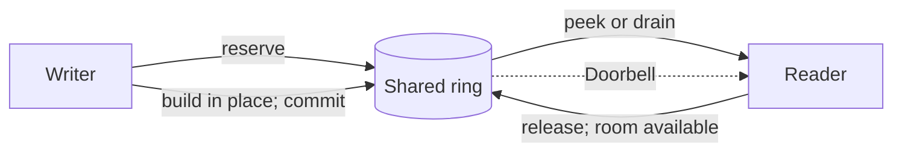
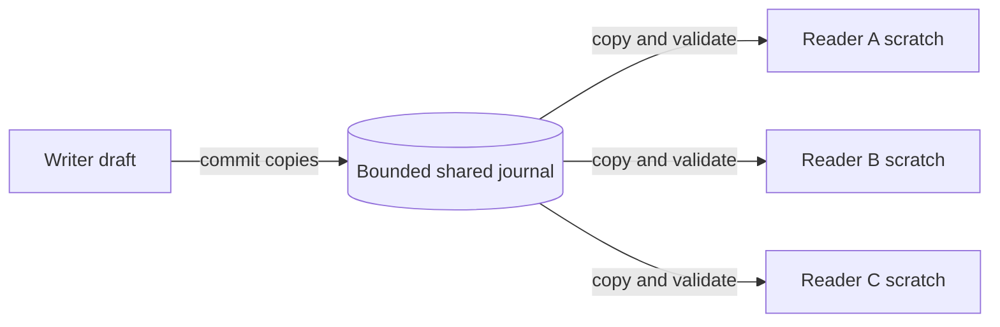
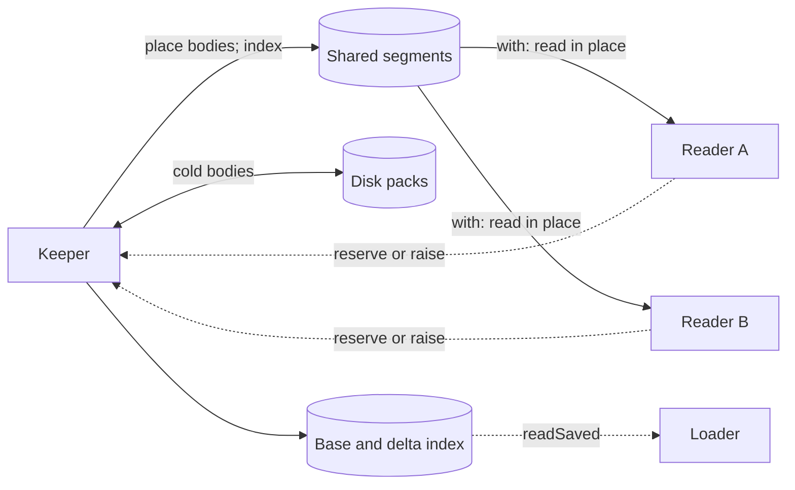

# How Cellar works, drawn

[Home](../README.md) · [Benchmarks](../docs/benchmarks.md)

Each mechanism as the threads see it. Runnable Node.js examples can be launched from the repository root.

| Example | Run |
| --- | --- |
| RPC and shared samples | `node examples/call-a-worker.mjs` |
| Memory and GC | `node examples/memory.mjs` |
| Pointer events and idle round trips | `node examples/ring.mjs` |
| Batches, transfer versus write versus reserve | `node examples/batches.mjs` |

## Bell

```mermaid
sequenceDiagram
    participant A as Waiting thread
    participant W as Shared words
    participant B as Publishing thread
    A->>W: Look at word
    A->>W: Register wait; check again
    A->>W: Wait if unchanged
    B->>W: Publish new value
    B->>W: Notify registered wait
    W-->>A: Wake
    A->>W: Unregister wait
```

[Wait contracts and adaptive spin](../docs/bell.md).

## Channel

```mermaid
sequenceDiagram
    participant C as Client
    participant S as Server
    C->>C: Write request slot n
    C->>S: Publish asked
    S->>S: Read request; write answer slot n
    S->>C: Publish answered
    C->>C: Read answer; free slot
```

[Channel guide](../docs/channel.md).

## Ring



`write` copies into a reservation; `reserve` lets the writer build the record there. [Ring guide](../docs/ring.md).

## Doorbell

```mermaid
sequenceDiagram
    participant R as Reader
    participant D as Doorbell
    participant W as Ring writer
    R->>D: seen = generation
    R->>R: Drain all sources
    W->>D: Publish record; ring
    R->>D: Wait for change from seen
    D-->>R: Already moved; return
    R->>R: Drain again
```

[Doorbell guide](../docs/bell.md#doorbell).

## Journal



The writer overwrites old records without waiting. Each reader keeps its own sequence and receives a validated private scratch copy, not an in-place shared view. [Journal guide](../docs/journal.md).

## Cache



[Cache guide and page/worker example](../docs/cache.md).
