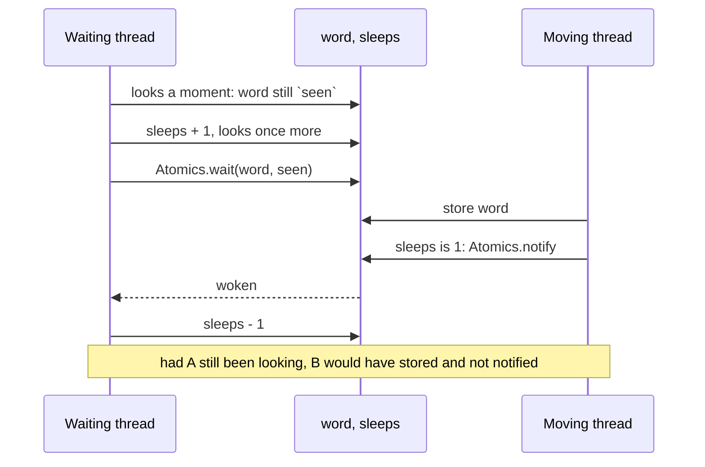
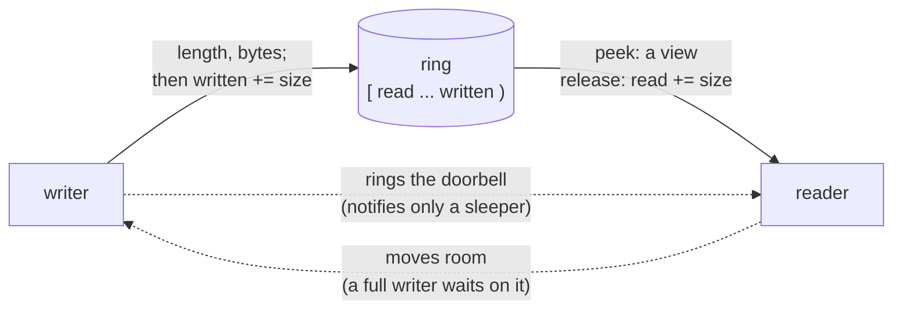
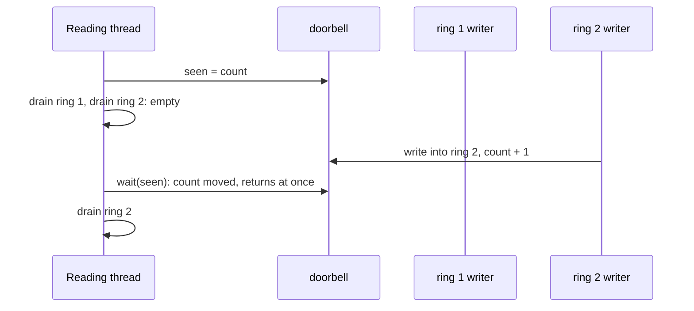
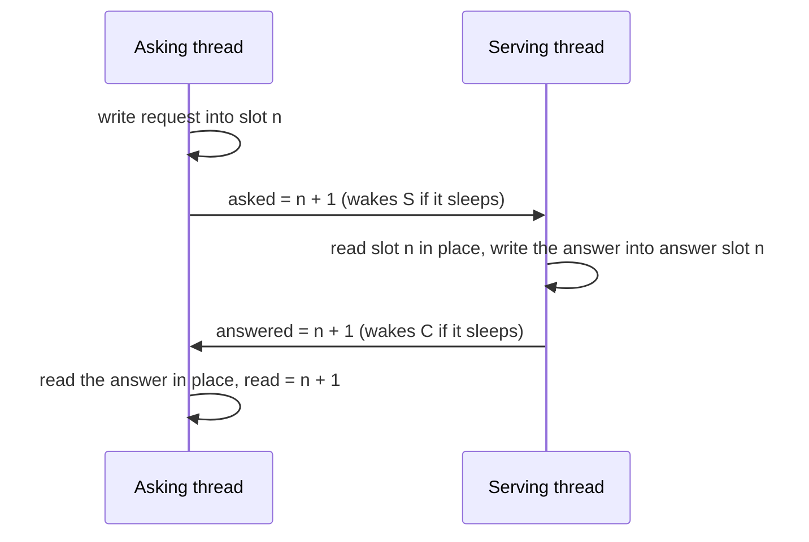
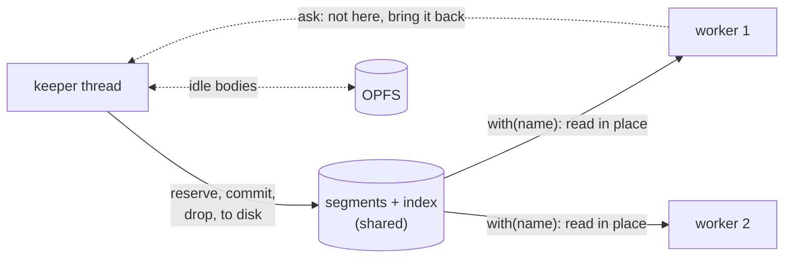

# How Cellar works, drawn

Each mechanism as the two threads see it, and the example that runs it. Words are 32-bit cells of a
`SharedArrayBuffer` both threads hold; nothing here is a message.

## Bell: one thread waits, another wakes it

A wait looks at its word for a moment (the other thread often moves it within microseconds), then
sleeps on it, counted in the word beside it. Whoever moves the word notifies only when that count
says a wait sleeps: a notify takes a lock every thread of the page shares, and is skipped while the
other side is still looking. The count is raised before the last look, so no wake is lost between
the look and the sleep.

`bell.js` (`waitFor`, `waitForAsync`, `wake`, `publish`, `ring`); its gate hands a turn back and
forth 20 000 times between two threads that always sleep.

## Ring: records one way, read in place

One writer, one reader. The counts of bytes ever written and ever read are the only state; a record
is its length and its bytes, whole in the buffer, so the reader gets a view of it, not a copy. A
record that would run past the end goes to the start behind a marker. A full ring refuses a record
rather than overwriting one, and a writer that may block waits for the reader to make room.

`examples/ring.mjs`: pointer moves to a worker busy with steps of work, drained between two steps
without giving its thread back; then events to the worker idle, asleep on the doorbell.
`examples/cache-lines.mjs`: whether the writer's and the reader's counts want cache lines of their
own on the machine it runs on (they share one in Cellar).

## Doorbell: one wait for many sources

A thread that reads several rings (input from the page, answers from another worker, records from a
third) gives them one doorbell. It reads the doorbell's count before it looks at any of them, and
waits for the count to move from what it read: whatever is written after its look rings it.

## Channel: calls between two threads

Requests go into slots one way, answers into slots the other, each side's counter published after
the slot's bytes. The asking thread blocks for its answer (a worker) or awaits it (any thread, a
page's own too); the serving thread blocks or serves on its event loop. Both read in place.

`examples/call-a-worker.mjs`: small calls and sums over shared samples, by postMessage and by the
channel; `examples/memory.mjs`: the same, each arm in a process of its own, with its memory.

## Cache: bodies by name, one budget

One keeper thread places bodies in shared segments and keeps the index every thread reads. A reader
finds a body by name and reads it where it lies; a body unread for a while goes to the disk (OPFS)
and comes back when it is asked for.

The README's Use section opens a keeper and a reader.
